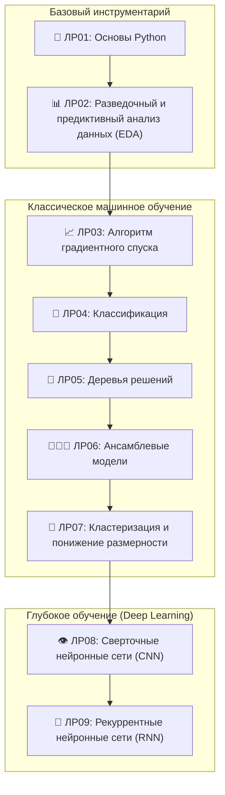

# Методы машинного обучения (ММО)

<div align="center">


**Учреждение образования «Белорусский государственный университет информатики и радиоэлектроники»**  
**Факультет компьютерных систем и сетей (ФКСиС)**  
**Кафедра программного обеспечения информационных технологий (ПОИТ)**  

</div>

---

## 📌 О репозитории

Данный репозиторий содержит полный цикл учебно-исследовательских материалов, лабораторных работ, программных реализаций и академических отчетов по дисциплине **«Методы машинного обучения» (ММО)** за **7 семестр (2026 год)**.

- **Студентка:** Алексейчик Яна Николаевна (гр. 351002)
- **GitHub:** [@Lexya06](https://github.com/Lexya06)
- **Преподаватель курса:** Лебедевич А. В.
- **Стандарт оформления отчетов:** СТП 01-2017 (БГУИР), верстка в LaTeX / Overleaf.

---

## 🗺️ Программа лабораторных работ курса

В ходе освоения курса изучаются и реализуются 9 масштабных лабораторных работ, охватывающих классические и современные методы анализа данных и машинного обучения:



### 📋 Подробная дорожная карта и статус выполнения:

| № | Название лабораторной работы | Ключевые изучаемые темы и методы | Директория | Статус |
|:---:|:---|:---|:---:|:---:|
| **ЛР01** | **Основы Python** | Синтаксис Python 3.12, структуры данных (`list`, `tuple`, `dict`, `set`), посимвольный парсинг строк, математические алгоритмы ($6k \pm 1$), интерактивный консольный интерфейс, обработка исключений `try/except/else/finally`, матричные операции, ООП (инкапсуляция, наследование, полиморфизм, `@classmethod`, `@staticmethod`). | [ЛР/ЛР1](file:///C:/Users/ASUS/BSUIR/7%20семестр/ММО/ЛР/ЛР1) | <kbd>Выполнено</kbd> |
| **ЛР02** | **Разведочный и предиктивный анализ данных (EDA)** | Пайплайн первичной обработки данных: загрузка датасета `StudentPerformanceFactors`, импутация категориальных пропусков модой, детектирование выбросов по правилу Тьюки ($1.5 \times IQR$), винсоризация (clipping), синтез 5 новых признаков (Feature Engineering), кодирование категорий (Binary, Ordinal, One-Hot), нормализация `MinMaxScaler` и стандартизация `StandardScaler`, визуализация 300 DPI (`matplotlib`, `seaborn`). | [ЛР/ЛР2](file:///C:/Users/ASUS/BSUIR/7%20семестр/ММО/ЛР/ЛР2) | <kbd>Выполнено</kbd> |
| **ЛР03** | **Алгоритм градиентного спуска** | Линейная регрессия с нуля: пакетный градиентный спуск (BGD), стохастический градиентный спуск (SGD) с адаптивным затуханием шага $\eta_k = \frac{\eta_0}{1 + \alpha k}$, исследование гиперпараметра скорости обучения $\eta \in [0.0005, 0.25]$, реализация L1-регуляризации Lasso через оператор мягкого порога (Soft-Thresholding, четный вариант 2), L2-регуляризация Ridge (Weight Decay), эталонное сопоставление со `scikit-learn`. | [ЛР/ЛР3](file:///C:/Users/ASUS/BSUIR/7%20семестр/ММО/ЛР/ЛР3) | <kbd>Выполнено</kbd> |
| **ЛР04** | **Классификация** | Постановка задачи бинарной и многоклассовой классификации, логистическая регрессия (сигмоида, Log-Loss), метод $k$-ближайших соседей (k-NN), метрики оценки качества: Accuracy, Precision, Recall, $F_1$-score, построение и анализ ROC-кривой и Precision-Recall кривой, расчет площади под кривой ROC-AUC, матрица ошибок (Confusion Matrix). | `ЛР/ЛР4` | ⏳ *В плане курса* |
| **ЛР05** | **Деревья решений** | Построение решающих деревьев (Decision Trees, CART / ID3), критерии расщепления вершин: энтропия Шеннона (Information Gain) и индекс неопределенности Джини (Gini Impurity), регуляризация деревьев от переобучения: ограничение максимальной глубины `max_depth`, минимального числа объектов `min_samples_split`, стрижка ветвей (прунинг), визуализация разделяющих поверхностей. | `ЛР/ЛР5` | ⏳ *В плане курса* |
| **ЛР06** | **Ансамблевые модели** | Ансамблирование базовых алгоритмов: бэггинг (BaggingClassifier/Regressor), метод случайного леса (Random Forest, Out-Of-Bag оценка, важность признаков Feature Importance), градиентный бустинг над деревьями решений (Gradient Boosting Machine), современные фреймворки бустинга: XGBoost, LightGBM, CatBoost, стеккинг моделей. | `ЛР/ЛР6` | ⏳ *В плане курса* |
| **ЛР07** | **Кластеризация и понижение размерности** | Обучение без учителя (Unsupervised Learning): алгоритм $K$-средних ($K$-Means, метод локтя / Elbow method), плотностная кластеризация DBSCAN, агломеративная иерархическая кластеризация и дендрограммы; алгоритмы понижения размерности признакового пространства: метод главных компонент (PCA), сингулярное разложение (SVD), нелинейное проецирование t-SNE. | `ЛР/ЛР7` | ⏳ *В плане курса* |
| **ЛР08** | **Сверточные нейронные сети** | Основы глубокого обучения (Deep Learning): архитектура сверточных сетей (CNN), математика операции свертки (Convolution), карты признаков (Feature Maps), слои подвыборки (Max/Average Pooling), функции активации (ReLU, LeakyReLU, Softmax), слои регуляризации Batch Normalization и Dropout, обучение сверточных сетей в PyTorch / TensorFlow для классификации изображений. | `ЛР/ЛР8` | ⏳ *В плане курса* |
| **ЛР09** | **Рекуррентные нейронные сети** | Моделирование последовательных данных и временных рядов: рекуррентные нейронные сети (RNN), проблема затухания и взрыва градиентов (Vanishing / Exploding Gradients), вентильные архитектуры: LSTM (Long Short-Term Memory) и GRU (Gated Recurrent Unit), механизмы внимания (Attention Mechanism), решение практических задач анализа текстов (NLP) и прогнозирования рядов. | `ЛР/ЛР9` | ⏳ *В плане курса* |

---

## 📚 Лекционный материал и теоретическая база

В директории [Материал/](file:///C:/Users/ASUS/BSUIR/7%20семестр/ММО/Материал) собраны официальные лекционные презентации кафедры и интерактивные блокноты Jupyter Notebook с эталонными примерами:

```text
Материал/
├── 00 Введение
├── 01 Встроенные типы данных Python и операции с ними
├── 02 Функции Python
├── 03 ООП в Python
├── 04 Python Numpy, Pandas
├── 05 Matplotlib, EDA
├── 06 Обзор алгоритмов обработки данных
├── 07 Алгоритм линейной регрессии. Градиентный спуск
├── 08 Линейная регрессия. Классификация
├── 09 Деревья принятия решений
├── 10 Ансамблевые модели
├── 11 Методы кластеризации
├── 12 Pipeline
├── 13 Введение в нейросети
├── 14 Сверточные сети
├── 15 Рекуррентные нейронные сети
└── Примеры кода из лекций/
    ├── 1 Python/              # Практика по ООП, Numpy, Pandas, Seaborn
    ├── 2 EDA/                 # Блокноты анализа пропусков и датасеты
    ├── 3 Linear regression/   # Реализация линейной и логистической регрессии
    ├── 4 Деревья решений/     # Классификация деревом решений
    └── 6 Нейросети/           # Keras, функции активации, Backprop, Optimizers
```

---

## 🏗️ Структура репозитория

Каждая лабораторная работа организована по единому строгому академическому стандарту:

```text
ММО/
├── .gitignore                         # Глобальные правила игнорирования временных файлов
├── README.md                          # Главный обзорный документ курса
├── Материал/                          # Презентации лекций и учебные Jupyter-ноутбуки
└── ЛР/
    ├── ЛР1/                           # Основы Python
    │   ├── Задание/                   # Методические указания кафедры (PDF)
    │   ├── Решение/                   # Исходный код (part1.py, part2.py, part3.py) + README.md
    │   └── Отчет/                     # LaTeX-исходник (report.tex), PDF и иллюстрации
    ├── ЛР2/                           # Разведочный анализ данных (EDA)
    │   ├── Задание/                   # Методичка и исходный датасет StudentPerformanceFactors
    │   ├── Решение/                   # Модульный пайплайн EDA (8 модулей) + README.md
    │   └── Отчет/                     # LaTeX-отчет по СТП 01-2017 + PDF
    └── ЛР3/                           # Алгоритм градиентного спуска и регуляризация
        ├── Задание/                   # Методичка по линейным моделям
        ├── Решение/                   # Классы BGD, SGD, L1 Lasso, L2 Ridge + README.md
        └── Отчет/                     # Полный академический LaTeX-отчет + PDF
```

---

## 🛠️ Стек технологий

- **Язык программирования:** Python 3.12+
- **Математические вычисления и анализ данных:** NumPy, SciPy, Pandas
- **Машинное обучение:** Scikit-Learn
- **Графическая визуализация:** Matplotlib, Seaborn
- **Глубокое обучение:** PyTorch / TensorFlow / Keras
- **Верстка отчетов:** LaTeX (pdfLaTeX, `tempora`, `geometry`, `fvextra`), Overleaf
- **Контроль версий:** Git, GitHub

---

## 🚀 Инструкция по установке и локальному запуску

### 1. Клонирование репозитория:
```bash
git clone https://github.com/Lexya06/MMO.git
cd MMO
```

### 2. Создание и активация виртуального окружения Python:
```bash
python -m venv .venv

# Для Windows (PowerShell):
.\.venv\Scripts\Activate.ps1

# Для Linux/macOS:
source .venv/bin/activate
```

### 3. Установка зависимостей:
```bash
pip install --upgrade pip
pip install numpy pandas matplotlib seaborn scikit-learn scipy jupyter
```

### 4. Запуск лабораторных работ:

#### Запуск Лабораторной работы №1:
```bash
cd "ЛР/ЛР1/Решение"
python part1.py   # Базовые структуры
python part2.py   # Функции и исключения
python part3.py   # ООП
```

#### Запуск Лабораторной работы №2:
```bash
cd "ЛР/ЛР2/Решение"
python solution.py
```

#### Запуск Лабораторной работы №3:
```bash
cd "ЛР/ЛР3/Решение"
python solution.py
```

---

## 👤 Автор

- **Алексейчик Яна Николаевна**
- Студентка 4 курса ФКСиС БГУИР, гр. 351002
- GitHub: [@Lexya06](https://github.com/Lexya06)
