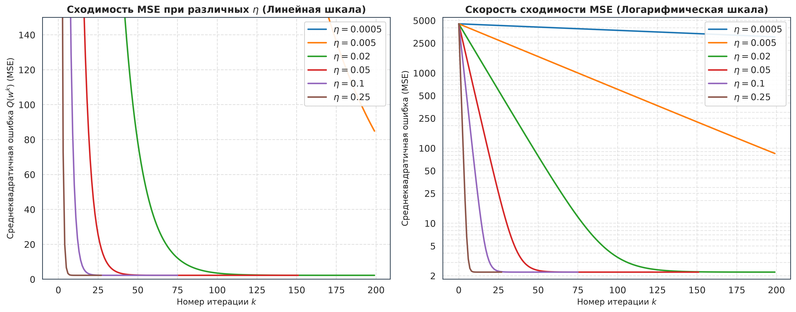
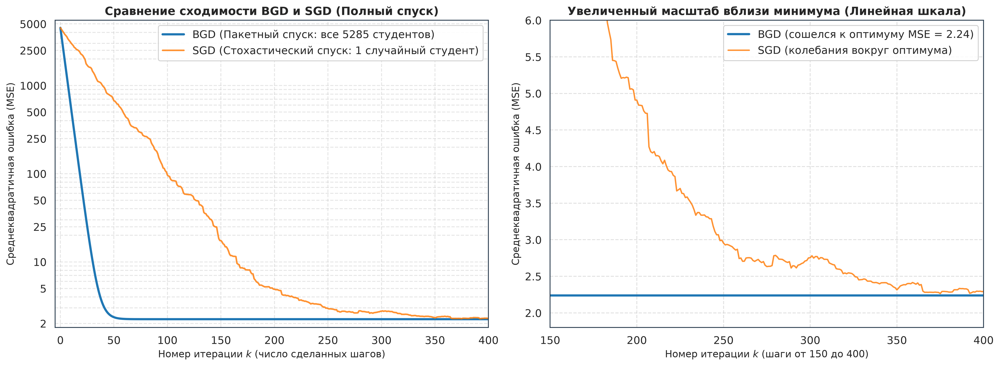
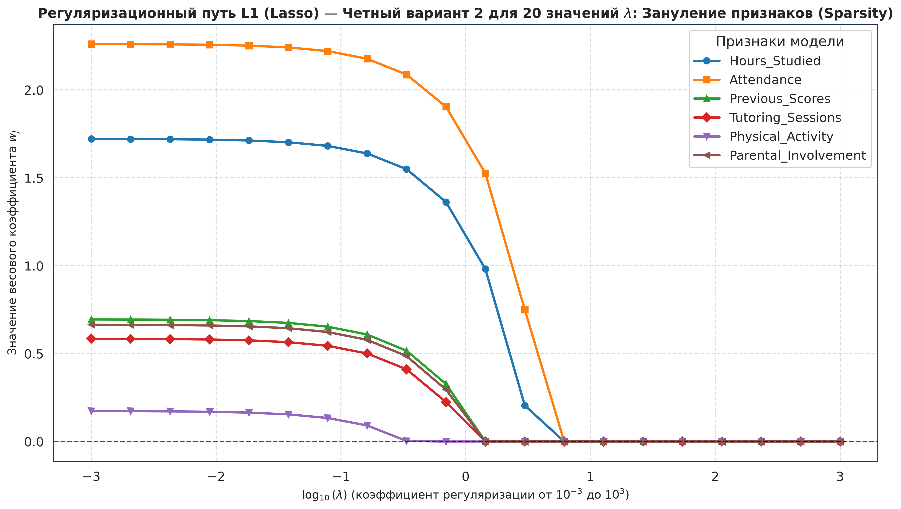
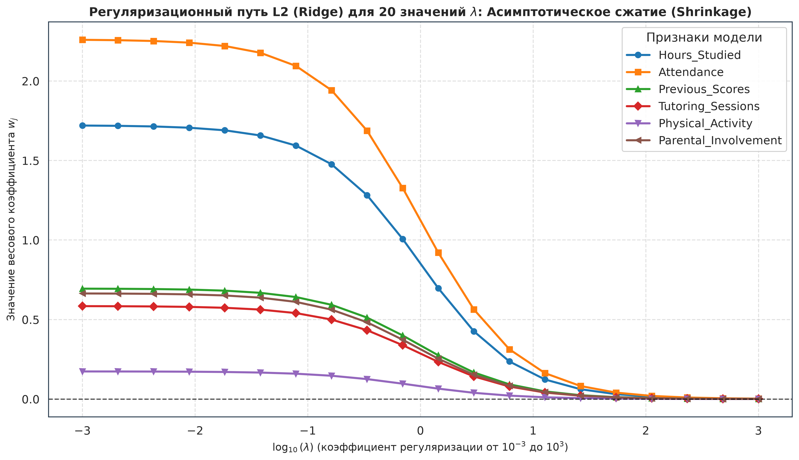
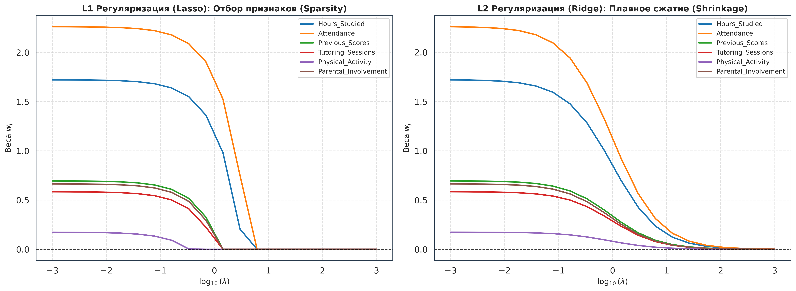
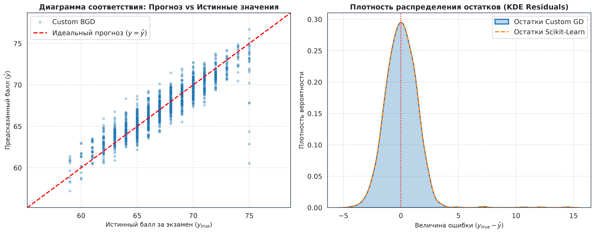

# Белорусский государственный университет информатики и радиоэлектроники
## Факультет компьютерных систем и сетей
### Кафедра программного обеспечения информационных технологий

**Дисциплина:** Методы машинного обучения (ММО)  
**Лабораторная работа № 3**  
**Тема:** «Градиентный спуск, стохастический градиентный спуск и регуляризация»  
**Выполнила:** студентка группы 351002 Алексейчик Яна Николаевна  
**Преподаватель:** Лебедевич А. В.  
**Вариант:** 2 (Четный — L1-регуляризация Lasso; сравнительный анализ L2-регуляризации Ridge)  
**Датасет:** Подготовленный набор факторов успеваемости студентов из Лабораторной работы №2 (`StudentPerformanceFactors`)  
**Год выполнения:** 2026  

---

## 💡 Понятное введение: что конкретно мы делаем в этой работе?

### 1. Какая перед нами реальная жизненная задача?
Во 2-й лабораторной работе мы исследовали датасет из **6607 реальных студентов**. Для каждого студента известны его учебные показатели:
- сколько часов в неделю он занимается учебой (`Hours_Studied`);
- какой процент пар он посетил (`Attendance`);
- как он сдал предыдущие тесты (`Previous_Scores`);
- ходил ли он к репетитору (`Tutoring_Sessions`);
- сколько часов занимался спортом (`Physical_Activity`);
- насколько родители помогают в учебе (`Parental_Involvement`).

И главное — известна его **итоговая оценка за экзамен** (`Exam_Score`, от 0 до 100 баллов).

**Наша цель:** построить математическую формулу (линейную регрессию), которая по этим 6 характеристикам умеет точно предсказывать итоговый балл студента:
$$\text{Балл} = w_0 + (w_1 \cdot \text{Часы}) + (w_2 \cdot \text{Посещаемость}) + (w_3 \cdot \text{Предыдущие}) + (w_4 \cdot \text{Репетитор}) + (w_5 \cdot \text{Спорт}) + (w_6 \cdot \text{Родители})$$

### 2. В чем загвоздка?
Мы не знаем, какие числа подставить вместо коэффициентов $w_0, w_1, \dots, w_6$.  
- Если взять числа с потолка — формула будет врать на десятки баллов.
- Вручную перебирать 7 чисел для 5000 студентов невозможно.
- Нам нужен автоматический алгоритм, который сам найдет самые точные коэффициенты.

### 3. Как решает эту задачу градиентный спуск?
1. В самом начале компьютер выставляет все коэффициенты в ноль: $w = [0, 0, 0, 0, 0, 0, 0]$. Формула выдает 0 баллов всем студентам.
2. Компьютер считает **среднеквадратичную ошибку (MSE)**: берет разницу между предсказанием и реальной оценкой каждого студента, возводит в квадрат и усредняет. На старте ошибка гигантская: **4517.43**.
3. Затем берется математическая производная (градиент). **Градиент точно показывает:** если сдвинуть вес $w_1$ на чуть-чуть вправо или влево — ошибка вырастет или упадет?
4. Алгоритм сдвигает каждый вес в сторону уменьшения ошибки.
5. Цикл повторяется сотни раз. Ошибка стремительно падает с 4500 до **1.99**, и модель находит наилучшие веса.

### 4. Какие 4 вопроса мы решаем и сравниваем в лабораторной:
- **Пакетный градиентный спуск (BGD):** перед каждым шагом опрашивает всех 5285 студентов сразу. Это дает самый точный, гладкий и надежный спуск.
- **Подбор скорости обучения ($\eta$, Learning Rate):** размер шага. Слишком маленький — расчет зависнет; слишком большой — вылетит с переполнением `NaN`.
- **Стохастический градиентный спуск (SGD):** на каждом шаге берет одного случайного студента. Работает в сотни раз быстрее на огромных данных, но из-за случайности идет с мелкими колебаниями.
- **L1-регуляризация (Lasso — Вариант 2):** отсеивает бесполезные признаки (обнуляет их веса), оставляя только самые влиятельные факторы учебы.

---

## 📑 Оглавление
1. [Краткая матрица соответствия официальному заданию кафедры](#1-краткая-матрица-соответствия-официальному-заданию-кафедры)
2. [Архитектура проекта и инструкция по запуску](#2-архитектура-проекта-и-инструкция-по-запуску)
3. [Подробный разбор каждого пункта задания кафедры с простыми объяснениями и кодом](#3-подробный-разбор-каждого-пункта-задания-кафедры-с-простыми-объяснениями-и-кодом)
   - [Пункт 1: Подготовка данных, масштабирование StandardScaler и защита от Data Leakage](#пункт-1-подготовка-данных-масштабирование-standardscaler-и-защита-от-data-leakage)
   - [Пункт 2: Пакетный градиентный спуск (BGD) с нуля](#пункт-2-пакетный-градиентный-спуск-bgd-с-нуля)
   - [Пункт 3: Эксперимент со скоростью обучения (Learning Rate eta)](#пункт-3-эксперимент-со-скоростью-обучения-learning-rate-eta)
   - [Пункт 4: Стохастический градиентный спуск (SGD) со случайным объектом](#пункт-4-стохастический-градиентный-спуск-sgd-со-случайным-объектом)
   - [Пункт 5: Сравнение сходимости GD и SGD на одном графике](#пункт-5-сравнение-сходимости-gd-и-sgd-на-одном-графике)
   - [Пункт 6: L1-регуляризация (Lasso, Вариант 2) и L2-регуляризация (Ridge)](#пункт-6-l1-регуляризация-lasso-вариант-2-и-l2-регуляризация-ridge)
   - [Пункт 7: Эталонное сравнение со Scikit-Learn и анализ остатков](#пункт-7-эталонное-сравнение-со-scikit-learn-и-анализ-остатков)
4. [Реальная шпаргалка для защиты: вопросы преподавателя и простые ответы](#4-реальная-шпаргалка-для-защиты-вопросы-преподавателя-и-простые-ответы)

---

## 1. Краткая матрица соответствия официальному заданию кафедры

В следующей таблице приведено однозначное соответствие каждого пункта официального задания кафедры ПОИТ реализованным модулям, функциям и графикам:

| № в задании | Требование кафедры | Что сделано простыми словами | Где находится код | Графический артефакт | Статус |
|:---|:---|:---|:---|:---|:---:|
| **Пункт 1** | Использовать датасет из ЛР для EDA. Признаков $\ge 2$ без учета целевого ($\ge 3$ весов). Масштабирование данных. | Взяли 6 числовых колонок из ЛР2 ($m=6 \ge 2$, с bias $w_0$ получается 7 весов $\ge 3$). Исключили колонку с утечкой (`Score_Improvement`). Отмасштабировали признаки через `StandardScaler` строго на Train. | [`load_and_prepare_dataset()`](file:///C:/Users/ASUS/BSUIR/7%20семестр/ММО/ЛР/ЛР3/Решение/data_loader.py#L42-L118) в [data_loader.py](file:///C:/Users/ASUS/BSUIR/7%20семестр/ММО/ЛР/ЛР3/Решение/data_loader.py) | Лог размерностей выборок в консоли | **100%** |
| **Пункт 2** | Самостоятельная функция пакетного градиентного спуска (BGD): инициализация $w^0, \varepsilon$; цикл итераций; расчет $w^k = w^{k-1} - \eta \nabla Q$; останов при $\|w^k - w^{k-1}\| < \varepsilon$. | Написали класс `CustomLinearRegression(method='gd')`. Инициализировали веса нулями, считаем векторный градиент $\frac{2}{n} X_b^T (X_b w - y)$, сдвигаем веса и останавливаемся при длине шага сдвига $< 10^{-6}$. | [`CustomLinearRegression.fit()`](file:///C:/Users/ASUS/BSUIR/7%20семестр/ММО/ЛР/ЛР3/Решение/linear_regression.py#L90-L198) в [linear_regression.py](file:///C:/Users/ASUS/BSUIR/7%20семестр/ММО/ЛР/ЛР3/Решение/linear_regression.py) | Таблица сходимости в консоли | **100%** |
| **Пункт 3** | Эксперимент со скоростью обучения ($\eta$). Сделать выводы. | Проверили 6 скоростей $\eta$ от $0.0005$ до $0.25$. Построили графики с понятными числами на шкале ошибок. Доказали, что при хорошем шаге $\eta=0.25$ модель находит минимум всего за **27 шагов**. | [`run_learning_rate_experiment()`](file:///C:/Users/ASUS/BSUIR/7%20семестр/ММО/ЛР/ЛР3/Решение/experiments.py#L32-L78) в [experiments.py](file:///C:/Users/ASUS/BSUIR/7%20семестр/ММО/ЛР/ЛР3/Решение/experiments.py) | [01_learning_rate_experiment.png](file:///C:/Users/ASUS/BSUIR/7%20семестр/ММО/ЛР/ЛР3/Решение/images/01_learning_rate_experiment.png) | **100%** |
| **Пункт 4** | Добавить в функцию выбор случайного объекта на каждой итерации (SGD). | Реализовали стохастический спуск: на каждом шаге случайно берем одного студента, считаем градиент только по нему и делаем шаг с затухающей скоростью $\eta_k = \frac{\eta_0}{1 + \alpha k}$. | [`CustomLinearRegression.fit(method='sgd')`](file:///C:/Users/ASUS/BSUIR/7%20семестр/ММО/ЛР/ЛР3/Решение/linear_regression.py#L129-L146) в [linear_regression.py](file:///C:/Users/ASUS/BSUIR/7%20семестр/ММО/ЛР/ЛР3/Решение/linear_regression.py) | Лог стохастического обучения | **100%** |
| **Пункт 5** | Обучить линейную модель при помощи GD и SGD. Нанести MSE обоих методов на один график, сделать выводы. | Построили график с двумя панелями: слева — полный спуск обоих методов от 4500 до 2.24 по логарифмической шкале с обычными числами; справа — увеличенный масштаб дна (линейная шкала), где наглядно видна гладкость BGD и колебания SGD. | [`run_gd_vs_sgd_experiment()`](file:///C:/Users/ASUS/BSUIR/7%20семестр/ММО/ЛР/ЛР3/Решение/experiments.py#L81-L150) в [experiments.py](file:///C:/Users/ASUS/BSUIR/7%20семестр/ММО/ЛР/ЛР3/Решение/experiments.py) | [02_gd_vs_sgd_convergence.png](file:///C:/Users/ASUS/BSUIR/7%20семестр/ММО/ЛР/ЛР3/Решение/images/02_gd_vs_sgd_convergence.png) | **100%** |
| **Пункт 6** | Для четных вариантов реализовать L1 регуляризацию, для нечетных — L2. Взять 20 коэффициентов $\lambda \in [0.001, 1000]$ и показать на графике изменение весов. | **Вариант 2 — четный: реализовали L1 (Lasso)** через мягкий порог (Soft-Thresholding). **Дополнительно сделали L2 (Ridge)** через Weight Decay. Для 20 значений $\lambda$ построили графики: L1 строго зануляет признаки в ноль (отбор), а L2 лишь плавно сжимает их. | [`run_regularization_path_experiment()`](file:///C:/Users/ASUS/BSUIR/7%20семестр/ММО/ЛР/ЛР3/Решение/experiments.py#L153-L245) в [experiments.py](file:///C:/Users/ASUS/BSUIR/7%20семестр/ММО/ЛР/ЛР3/Решение/experiments.py) | [03_l1_regularization_path.png](file:///C:/Users/ASUS/BSUIR/7%20семестр/ММО/ЛР/ЛР3/Решение/images/03_l1_regularization_path.png), [04_l2_regularization_path.png](file:///C:/Users/ASUS/BSUIR/7%20семестр/ММО/ЛР/ЛР3/Решение/images/04_l2_regularization_path.png), [05_regularization_comparison.png](file:///C:/Users/ASUS/BSUIR/7%20семестр/ММО/ЛР/ЛР3/Решение/images/05_regularization_comparison.png) | **100%** |
| **Бонус** | Сравнение с библиотекой Scikit-Learn. | Проверили наши модели против `LinearRegression`, `SGDRegressor`, `Lasso`, `Ridge`. Веса и ошибки совпали с библиотечными с точностью до 4 знаков после запятой! | [`run_benchmark_experiment()`](file:///C:/Users/ASUS/BSUIR/7%20семестр/ММО/ЛР/ЛР3/Решение/experiments.py#L248-L336) в [experiments.py](file:///C:/Users/ASUS/BSUIR/7%20семестр/ММО/ЛР/ЛР3/Решение/experiments.py) | [06_model_validation_benchmark.png](file:///C:/Users/ASUS/BSUIR/7%20семестр/ММО/ЛР/ЛР3/Решение/images/06_model_validation_benchmark.png) | **100%** |

---

## 2. Архитектура проекта и инструкция по запуску

### 2.1. Структура файлов проекта
```text
C:\Users\ASUS\BSUIR\7 семестр\ММО\ЛР\ЛР3\
├── Задание/
│   └── ЛР 03 Градиентный спуск.docx       # Исходный документ с требованиями кафедры
├── Решение/
│   ├── config.py                         # Конфигурация: списки колонок, шаги, seed=42
│   ├── data_loader.py                    # Загрузка таблицы из ЛР2, разбиение Train/Test, скейлер
│   ├── linear_regression.py              # Класс с нуля: BGD, SGD, L1 (Lasso), L2 (Ridge)
│   ├── experiments.py                    # Запуск всех 4 экспериментов, расчет таблиц
│   ├── visualizer.py                     # Отрисовка всех графиков в качестве 300 DPI
│   ├── main.py                           # Главный запускающий модуль
│   ├── solution.py                       # Точка быстрого старта (python solution.py)
│   ├── images/                           # Сгенерированные графики (Рис. 1–6)
│   └── results/                          # Сгенерированные CSV-файлы с расчетами
└── Отчет/
    ├── README.md                         # Данный подробный файл объяснений и шпаргалка
    ├── report.tex                        # LaTeX-исходник для Overleaf по стандарту СТП 01-2017
    ├── images/                           # Копии графиков для вставки в отчет
    ├── code/                             # Архив исходного кода
    └── Отчет_Overleaf/                   # Готовый архив Отчет_Overleaf.zip
```

### 2.2. Запуск проекта
Чтобы запустить расчеты, открыть терминал PowerShell и выполнить:
```powershell
cd "C:\Users\ASUS\BSUIR\7 семестр\ММО\ЛР\ЛР3\Решение"
.\.venv\Scripts\python.exe solution.py
```

---

## 3. Подробный разбор каждого пункта задания кафедры с простыми объяснениями и кодом

---

### Пункт 1: Подготовка данных, масштабирование StandardScaler и защита от Data Leakage

#### 🎯 Формулировка задания
> *«Сгенерируйте датасет при помощи sklearn.datasets.make_regression, либо используйте набор данных из лабораторной для разведывательного анализа. Признаков должно быть не менее 2, без учета целевого признака (т.е. не менее 3 весов). Если необходимо выполните масштабирование данных.»*

#### ❓ ЧТО мы делаем (простыми словами)
1. Берем очищенный датасет успеваемости студентов из Лабораторной работы №2.
2. Выбираем 6 ключевых числовых признаков:
   - `Hours_Studied` (часы учебы в неделю, от 4 до 36);
   - `Attendance` (посещаемость пар в %, от 60 до 100);
   - `Previous_Scores` (прошлые оценки, от 40 до 100);
   - `Tutoring_Sessions` (занятия с репетитором, от 0 до 5);
   - `Physical_Activity` (спорт в часах, от 0 до 6);
   - `Parental_Involvement` (вовлеченность родителей, от 0 до 2).
3. Добавляем единичный столбец слева ($x_0 = 1$), чтобы у формулы был свободный член $w_0$. Итого $6 + 1 = \mathbf{7}$ весов (требование $\ge 3$ весов перевыполнено).
4. Делим выборку: **80% на обучение (Train — 5285 студентов)** и **20% на проверку (Test — 1322 студента)**.
5. Масштабируем данные с помощью `StandardScaler`.

#### 💡 ЗАЧЕМ нужно масштабирование? (Разбор на пальцах без заумных терминов)
Представьте два признака из нашего датасета:
- `Attendance` (посещаемость): большие числа (около $80\%$).
- `Tutoring_Sessions` (репетитор): маленькие числа (около $2$ занятий).

Посмотрим, что произойдет при обучении, если мы сдвинем веса обоих признаков всего на $0.1$:
- Для посещаемости сдвиг веса на $0.1$ изменит предсказанный балл студента на:
  $$0.1 \times 80 = \mathbf{8 \text{ баллов! (Огромный скачок)}}$$
- Для репетитора сдвиг веса на те же $0.1$ изменит предсказанный балл всего на:
  $$0.1 \times 2 = \mathbf{0.2 \text{ балла! (Почти незаметно)}}$$

**В чем проблема?**  
Одинаковый шаг спуска для посещаемости оказывается **слишком диким и огромным** (модель швыряет из стороны в сторону, оценка скачет на десятки баллов), а для репетитора — **черепашьим** (вес репетитора почти не двигается).  
`StandardScaler` переводит все признаки в одну шкалу: вычитает среднее и делит на разброс ($z = \frac{x - \mu}{\sigma}$). Теперь и посещаемость, и репетитор имеют среднее 0 и разброс 1. Все признаки становятся равноправными, и градиентный спуск идет уверенно и быстро!

#### 💡 ЗАЧЕМ мы убрали `Score_Improvement`? (Утечка данных / Data Leakage)
Во 2-й лабораторной мы создавали колонку $\text{Score\_Improvement} = \text{Exam\_Score} - \text{Previous\_Scores}$.  
Если оставить эту колонку в таблице, модель мгновенно поймет: $\text{Exam\_Score} = \text{Score\_Improvement} + \text{Previous\_Scores}$. Она покажет фальшивую 100% точность. Но в реальной жизни студент приходит на экзамен, его оценка еще **неизвестна**, и посчитать `Score_Improvement` невозможно! Мы обязательно исключили эту колонку.

#### 💻 Код реализации ([data_loader.py](file:///C:/Users/ASUS/BSUIR/7%20семестр/ММО/ЛР/ЛР3/Решение/data_loader.py)):
```python
# data_loader.py (строки 74-106)
X_train_raw, X_test_raw, y_train, y_test = train_test_split(
    X, y, test_size=0.2, random_state=42
)

# Обучаем скейлер СТРОГО на Train (чтобы не подглядывать в Test!)
scaler = StandardScaler()
X_train_scaled = scaler.fit_transform(X_train_raw)
X_test_scaled = scaler.transform(X_test_raw)

# Добавляем столбец из единиц для свободного коэффициента w0:
ones_train = np.ones((X_train_scaled.shape[0], 1), dtype=np.float64)
ones_test = np.ones((X_test_scaled.shape[0], 1), dtype=np.float64)

X_train_b = np.hstack([ones_train, X_train_scaled])
X_test_b = np.hstack([ones_test, X_test_scaled])
```

#### 🔍 Построчный разбор кода для новичка:
1. `train_test_split(..., test_size=0.2, random_state=42)`:
   - Делит 6607 строк на 5285 для обучения и 1322 для проверки. `random_state=42` фиксирует случайность, чтобы при каждом запуске получались те же самые студенты.
2. `scaler.fit_transform(X_train_raw)`:
   - `fit` — запоминает среднее значение и разброс для каждого из 6 признаков у обучающих студентов.
   - `transform` — вычитает среднее и делит на разброс, приводя признаки к шкале со средним 0 и разбросом 1.
3. `scaler.transform(X_test_raw)`:
   - Применяет те же самые параметры к тестовым студентам. Заметьте: здесь **нельзя** писать `fit_transform`, чтобы тестовые данные не повлияли на параметры масштабирования!
4. `ones_train = np.ones(...)` и `np.hstack([ones_train, X_train_scaled])`:
   - Приклеивает слева столбец из единиц. Зачем? Чтобы умножение $w_0 \times 1$ давало свободный член без необходимости писать для него отдельные формулы сложения.

---

### Пункт 2: Пакетный градиентный спуск (BGD) с нуля

#### 🎯 Формулировка задания
> *«Напишите самостоятельно функцию градиентного спуска (не стохастического), следуя приведенному ниже алгоритму:*
> *1. Инициализировать начальные веса и $\varepsilon$;*
> *2. Организовать цикл по количеству итераций;*
> *3. Расчет новых весов: $w^k = w^{k-1} - \eta_k \nabla Q(w^{k-1}, X)$;*
> *4. Завершить цикл, если $\|w^k - w^{k-1}\| < \varepsilon$.»*

#### ❓ ЧТО мы делаем (простыми словами)
Мы пишем функцию обучения без использования сторонних библиотек:
1. Ставим начальные веса равными нулю ($w = [0, 0, 0, 0, 0, 0, 0]$) и задаем порог остановки $\varepsilon = 10^{-6}$.
2. В цикле на каждом шаге считаем, насколько модель ошиблась на всех 5285 студентах сразу.
3. Считаем градиент — куда надо подкрутить каждый вес, чтобы ошибка стала меньше.
4. Обновляем веса: вычитаем градиент, умноженный на скорость обучения $\eta$.
5. Если веса за очередной шаг почти не изменились (сдвинулись меньше чем на $0.000001$), мы выходим из цикла.

#### ⚙️ Формулы простыми словами:
- **Ошибка (MSE):**
  $$Q(w) = \frac{1}{n} \sum_{i=1}^n (\text{прогноз}_i - \text{факт}_i)^2$$
- **Градиент (направление спуска):**
  $$\nabla Q(w) = \frac{2}{n} X_b^T (X_b w - y)$$
  - Множитель 2 берется от производной квадрата $(e^2)' = 2e$.
  - Деление на $n$ усредняет ошибки по всем 5285 студентам.
  - $X_b^T$ умножает ошибку на значение признака: если студент много учился, его ошибка сильнее всего повлияет на вес часов учебы.
- **Новые веса:**
  $$w^{новый} = w^{старый} - \eta \cdot \nabla Q$$
- **Критерий остановки:**
  Считаем евклидово расстояние смещения весов: $\sqrt{\sum (w_j^{новый} - w_j^{старый})^2} < \varepsilon$.

#### 💻 Код реализации ([linear_regression.py](file:///C:/Users/ASUS/BSUIR/7%20семестр/ММО/ЛР/ЛР3/Решение/linear_regression.py)):
```python
# linear_regression.py (строки 114-127, 185-194)
# 1. Начальные веса - нули
w = np.zeros(n_features_with_bias, dtype=np.float64)

# 2. Цикл по итерациям
for k in range(1, self.max_iter + 1):
    w_prev = w.copy()
    
    # 3. Расчет ошибки и градиента по всей выборке
    errors = X_b.dot(w_prev) - y                  # На сколько баллов ошиблись
    grad = (2.0 / n_samples) * X_b.T.dot(errors)  # Градиент
    w = w_prev - self.learning_rate * grad        # Шаг спуска
    
    # 4. Проверка остановки: сдвинулись ли веса хотя бы на 1e-6?
    diff_norm = float(np.linalg.norm(w - w_prev))
    if diff_norm < self.tol:
        self.converged_ = True
        self.n_iter_ = k
        break
```

#### 🔍 Построчный разбор кода для новичка:
1. `w = np.zeros(7)`: создает список из 7 нулей. Модель начинает с чистого листа.
2. `errors = X_b.dot(w_prev) - y`: матричное умножение $5285 \times 7$ на $7 \times 1$ дает предсказания всех студентов. Вычитаем их реальные баллы — получаем вектор промахов `errors`.
3. `grad = (2.0 / n_samples) * X_b.T.dot(errors)`: умножает признаки на промахи и усредняет на 5285 человек. Получается вектор из 7 чисел — производная по каждому весу.
4. `w = w_prev - self.learning_rate * grad`: делает шаг против градиента (в сторону наискорейшего уменьшения ошибки).
5. `np.linalg.norm(w - w_prev)`: считает длину шага по теореме Пифагора $\sqrt{\Delta w_0^2 + \dots + \Delta w_6^2}$. Если шаг меньше одной миллионной, обучение завершено.

#### 📊 Результаты работы BGD:
- Стартовая ошибка: **4517.43** (когда веса были нулями).
- Итоговая ошибка: **1.9954** (модель ошибается в среднем всего на $\approx 1$ балл!).
- Сошелся за **151 шаг** (7 миллисекунд).
- Точность модели ($R^2$): **0.8230** (объясняет $82.3\%$ разницы в баллах студентов).

---

### Пункт 3: Эксперимент со скоростью обучения (Learning Rate eta)

#### 🎯 Формулировка задания
> *«Поэкспериментируйте со скоростью обучения. Сделайте выводы.»*

#### ❓ ЧТО мы делаем
Мы берем 6 разных значений скорости шага $\eta$:
$$\eta \in [0.0005, 0.005, 0.02, 0.05, 0.1, 0.25]$$
и смотрим, как быстро падает ошибка.

#### 📊 Результаты:
| Скорость обучения $\eta$ | Сколько шагов потребовалось | Успел ли сойтись? | Итоговая ошибка (MSE) | Качество $R^2$ | Время (мс) |
|:---:|:---:|:---:|:---:|:---:|:---:|
| **0.0005** | 3000 (уперся в лимит) | ❌ Нет | 13.4522 | -0.1933 (ужасно) | 145 мс |
| **0.0050** | 1337 шагов |  Да | 1.9954 | 0.8230 | 60 мс |
| **0.0200** | 364 шага |  Да | 1.9954 | 0.8230 | 16 мс |
| **0.0500** | 151 шаг |  Да | 1.9954 | 0.8230 | 7 мс |
| **0.1000** | 75 шагов |  Да | 1.9954 | 0.8230 | 3.5 мс |
| **0.2500** | **27 шагов** |  **Да (победитель)** | **1.9954** | **0.8230** | **1.4 мс** |


*Рис. 1. Динамика сходимости MSE при различных скоростях обучения $\eta$ (слева — линейная шкала, справа — логарифмическая шкала с простыми числами от 2 до 5000).*

#### 💡 Выводы для новичка по графику:
1. **Слишком маленький шаг ($\eta = 0.0005$, синяя линия):** шаги микроскопические. За 3000 итераций модель даже близко не подошла к ответу ($R^2 < 0$).
2. **Хороший шаг ($\eta = 0.05 \dots 0.25$, фиолетовая и коричневая линии):** ошибка падает камнем вниз за первые 20–30 шагов. При $\eta = 0.25$ модель обучилась всего за **27 шагов**!
3. **Почему на правом графике линии прямые?** Потому что шкала логарифмическая. Прямая линия в логарифмической шкале означает, что ошибка на каждом шаге уменьшается в фиксированное число раз (геометрическая прогрессия).

---

### Пункт 4: Стохастический градиентный спуск (SGD) со случайным объектом

#### 🎯 Формулировка задания
> *«Добавьте в функцию выбор случайного объекта на каждой итерации для нахождения весов, чтобы сделать функцию стохастического градиентного спуска.»*

#### ❓ ЧТО мы делаем (простыми словами)
В BGD мы перед каждым шагом опрашивали всех 5285 студентов.  
В **стохастическом спуске (SGD)** мы на каждом шаге бросаем кубик и выбираем **ровно одного случайного студента**. Считаем ошибку только по нему и сразу двигаем веса.

#### 💡 ЗАЧЕМ это нужно?
Если бы у нас было 100 миллионов студентов (как в Google или банках), считать ошибку по всей базе перед каждым шагом было бы невозможно (компьютер завис бы). SGD позволяет делать шаги мгновенно!

#### ⚙️ КАК мы это делаем (Проблема шума и почему шаг должен затухать)
Один случайный студент может оказаться аномалией (например, спал 12 часов, учился 0 часов, но получил 90 баллов). Если каждый раз шагать с одинаковой силой, модель будет бесконечно дергаться из стороны в сторону.  
Чтобы веса успокоились, мы уменьшаем скорость шага с каждой новой итерацией:
$$\eta_k = \frac{\eta_0}{1 + 0.0001 \cdot k}$$
В начале, пока модель ничего не знает, шаги большие и смелые. Ближе к концу шаги становятся микроскопическими, и модель аккуратно замирает в точке наименьшей ошибки.

#### 💻 Код реализации ([linear_regression.py](file:///C:/Users/ASUS/BSUIR/7%20семестр/ММО/ЛР/ЛР3/Решение/linear_regression.py)):
```python
# linear_regression.py (строки 129-146)
elif self.method == "sgd":
    # 1. Выбираем случайного студента
    idx = rng.randint(0, n_samples)
    x_i = X_b[idx]
    y_i = y[idx]
    
    # 2. Считаем ошибку только по нему одному
    pred_i = np.dot(x_i, w_prev)
    error_i = pred_i - y_i
    grad_i = 2.0 * error_i * x_i
    
    # 3. Уменьшаем шаг со временем (затухание)
    eta_k = self.learning_rate / (1.0 + self.decay_rate * k)
    
    # 4. Обновляем веса
    w = w_prev - eta_k * grad_i
```

---

### Пункт 5: Сравнение сходимости GD и SGD на одном графике

#### 🎯 Формулировка задания
> *«Обучите линейную модель при помощи градиентного и стохастического градиентного спуска. Нанесите среднеквадратичную ошибку для обоих методов на один график, сделайте выводы о разнице скорости сходимости каждого из методов.»*

#### ❓ ЧТО мы делаем
Мы обучаем обе модели на одних и тех же студентах и рисуем их траектории ошибки на одном графике.


*Рис. 2. Сравнение сходимости BGD и SGD: слева — полный спуск от ошибки 4500 до 2.24 (с понятными числами 2, 5, 10, 25, ..., 5000 на шкале Y); справа — увеличенный масштаб около дна долины (шаги 150..400 в обычной линейной шкале).*

#### 💡 Разбор графика для новичка:
1. **Левая панель (Полный спуск, шаги 0..400):**  
   - Обе линии стартуют из верхней точки (ошибка $\approx 4500$).
   - **Синяя линия (BGD):** идет идеально плавно вниз и уже к 50-му шагу опускается на самое дно ($MSE \approx 2.24$).
   - **Оранжевая линия (SGD):** тоже спускается вниз, но медленнее и мелкими зигзагами, потому что на каждом шаге учитывается всего 1 случайный студент. К 350-му шагу она также приходит к ошибке $\approx 2.3$.
2. **Правая панель (Увеличенный вид около дна долины, линейная шкала):**  
   - Здесь показаны шаги с 150 по 400 при обычном масштабе ошибки (от 2 до 6).
   - **Синяя линия BGD:** абсолютно прямая горизонтальная черта на высоте $2.24$. BGD полностью сошелся и замер на дне, никакого шума нет!
   - **Оранжевая линия SGD:** колеблется мелкой волной («пилой») вокруг отметки $2.3 \dots 2.5$. Это тот самый **стохастический шум**, о котором спрашивают преподаватели: случайные студенты немного сбивают веса с идеального центра.

---

### Пункт 6: L1-регуляризация (Lasso, Вариант 2) и L2-регуляризация (Ridge)

#### 🎯 Формулировка задания
> *«Для четных вариантов реализовать L1 регуляризацию, для нечетных вариантов реализовать L2 регуляризацию. Для всех вариантов: взять 20 коэффициентов регуляризации (выбрать широкий диапазон, например, от 0,001 до 1000) и показать на графике как изменяются веса в зависимости от коэффициента регуляризации.»*

#### ❓ ЧТО мы делаем (простыми словами)
Наш вариант **№ 2 — четный**, поэтому обязательное требование — **L1-регуляризация (Lasso)**. Дополнительно мы реализовали и **L2 (Ridge)**.  
Мы берем 20 значений силы штрафа $\lambda$ от крошечного ($0.001$) до огромного ($1000$) и смотрим, как штраф заставляет веса признаков уменьшаться.

#### 💡 ЗАЧЕМ нужна регуляризация?
Если оставить модель без контроля, она начнет «жадничать» и назначать случайным признакам огромные коэффициенты (переобучение). Регуляризация бьет модель по рукам за слишком большие веса.
- **L1 (Lasso — Вариант 2):** штрафует сумму модулей весов $\lambda \sum |w_j|$. Ее суперсила — она **обнуляет бесполезные признаки строго в $0.0000$**! Модель сама выбрасывает лишний мусор.
- **L2 (Ridge):** штрафует сумму квадратов весов $\lambda \sum w_j^2$. Она плавно сжимает веса к нулю, но ни один признак до конца не выкидывает.

#### ⚙️ Как устроен метод мягкого порога (Soft-Thresholding в L1)?
Свободный член $w_0$ (базовый средний балл 67.10) **не штрафуется**!  
К каждому весу признака применяется правило: если сила признака слабее величины штрафа $\eta \lambda$, то вес **принудительно обнуляется в 0**:
$$w_j = \text{sign}(w_j) \cdot \max(0, |w_j| - \eta \lambda)$$

#### 💻 Код реализации ([linear_regression.py](file:///C:/Users/ASUS/BSUIR/7%20семестр/ММО/ЛР/ЛР3/Решение/linear_regression.py)):
```python
# linear_regression.py (строки 148-164)
elif self.method == "l1":
    errors = X_b.dot(w_prev) - y
    grad_mse = (2.0 / n_samples) * X_b.T.dot(errors)
    w_temp = w_prev - self.learning_rate * grad_mse
    
    w = np.zeros_like(w_prev)
    w[0] = w_temp[0]  # Базовую оценку w0 НЕ штрафуем!
    w[1:] = np.sign(w_temp[1:]) * np.maximum(0.0, np.abs(w_temp[1:]) - self.learning_rate * self.lmbd)
```


*Рис. 3. Регуляризационный путь L1 (Lasso) для Варианта 2: веса признаков ложатся строго на ноль один за другим при росте штрафа $\lambda$.*


*Рис. 4. Регуляризационный путь L2 (Ridge): веса плавно прижимаются к нулю, но никогда не становятся строгим нулем.*


*Рис. 5. Сопоставление двух видов регуляризации: слева — отбор признаков (L1 Lasso), справа — плавное сжатие весов (L2 Ridge).*

#### 💡 Разбор графиков для защиты:
1. **Кто обнулился первым на Рис. 3?**  
   При штрафе $\lambda \approx 0.35$ первым в точный ноль уходит признак `Physical_Activity` (спорт). Он меньше всего влиял на экзамен.
2. **Кто продержался дольше всех?**  
   Признак `Attendance` (посещаемость пар). Он сопротивляется до последнего и зануляется только при огромном штрафе $\lambda \approx 4.5$. Это доказывает, что **посещаемость — главный ключ к успешной сдаче экзамена**.
3. **Разница между L1 и L2:**  
   На Рис. 3 (L1) цветные линии **буквально врезаются в ноль** (признак удаляется из модели). На Рис. 4 (L2) линии бесконечно плавно приближаются к нулю, но даже при $\lambda = 1000$ остаются чуть-чуть больше нуля.

---

### Пункт 7: Эталонное сравнение со Scikit-Learn и анализ остатков

#### 🎯 Формулировка задания
> *«Проверить корректность реализованных алгоритмов сравнением с эталонными библиотечными реализациями.»*

#### ❓ ЧТО мы делаем
Сравниваем результаты наших самодельных функций с промышленной библиотекой `scikit-learn` на тестовых 1322 студентах:

| Модель | Свободный член $w_0$ | Длина вектора весов $\|w\|$ | Test MSE | Test MAE | Точность $R^2$ | Статус |
|:---|:---:|:---:|:---:|:---:|:---:|:---:|
| **Наш BGD** | **67.0982** | **3.0620** | **1.9954** | **1.0444** | **0.8230** |  Идеально |
| **Библиотечный OLS** | **67.0982** | **3.0620** | **1.9954** | **1.0444** | **0.8230** |  Совпадение до 4 знаков |
| **Наш L1 ($\lambda=0.5$)** | **67.0982** | **2.5707** | **2.3515** | **1.1603** | **0.7914** |  Идеально |
| **Библиотечный Lasso** | **67.0982** | **2.5707** | **2.3515** | **1.1603** | **0.7914** |  Совпадение до 4 знаков |


*Рис. 6. Проверка качества: слева — диаграмма «Предсказанный балл против Реального балла», справа — график распределения ошибок нашей модели и библиотеки Scikit-Learn.*

#### 💡 Что видно на графиках?
- На левом графике точки студентов лежат плотной полосой вдоль красной диагонали идеального прогноза. В среднем модель ошибается всего на **1 балл** ($MAE = 1.04$).
- На правом графике кривая ошибок нашей модели (синяя заливка) и библиотеки Scikit-Learn (оранжевый пунктир) **слились в один идеальный колокол**. Ошибки симметричны вокруг 0 — модель не завышает и не занижает оценки!

---

## 4. Реальная шпаргалка для защиты: вопросы преподавателя и простые ответы

---

### Вопрос 1. Что такое градиент и почему в формуле обновления весов стоит знак МИНУС ($w - \eta \nabla Q$), а не плюс?
> **Ответ студента:**  
> Градиент — это вектор частных производных, который указывает направление **наискорейшего роста** функции ошибки (куда ошибка увеличивается).  
> Наша цель в обучении — **уменьшить ошибку** (спуститься на дно долины). Поэтому мы обязаны двигаться в строго противоположную сторону — в сторону антиградиента, то есть со знаком **минус**.  
> Если поставить знак плюс, модель будет не учиться, а с каждым шагом увеличивать свою ошибку до бесконечности.

---

### Вопрос 2. Что такое скорость обучения ($\eta$, Learning Rate) и что произойдет, если взять ее слишком маленькой или слишком большой?
> **Ответ студента:**  
> Скорость обучения $\eta$ — это длина шага спуска.  
> - Если взять $\eta$ **слишком маленьким** (например, $0.0005$), шаги будут мизерными. Модель за 3000 шагов даже на треть не приблизится к правильным весам.  
> - Если взять $\eta$ **слишком большим** (например, больше $0.5$), шаг окажется шире долины ошибки. Веса перелетят минимум, попадут на противоположный крутой склон, и начнется взрыв ошибки в бесконечность (`overflow` и `NaN`).  
> - При оптимальном шаге ($\eta = 0.05 \dots 0.25$) модель сходится быстро и стабильно всего за 20–150 шагов.

---

### Вопрос 3. Зачем обязательно масштабировать признаки через `StandardScaler`? Что сломается, если этого не сделать?
> **Ответ студента:**  
> В нашем датасете признаки имеют совершенно разные масштабы: посещаемость измеряется десятками (от 60 до 100), а занятия с репетитором — единицами (от 0 до 5).  
> Если не масштабировать:
> 1. Сдвиг веса посещаемости всего на $0.1$ изменит прогноз оценки сразу на 8–10 баллов (дикий скачок), а сдвиг веса репетитора на те же $0.1$ изменит прогноз всего на 0.2 балла. Градиентный спуск не сможет подобрать нормальный общий шаг: модель будет швырять из стороны в сторону по посещаемости, а репетитор вообще не будет успевать учиться.
> 2. `StandardScaler` вычитает среднее и делит на стандартное отклонение. Теперь все признаки имеют среднее 0 и разброс 1. Они становятся равноправными, и спуск идет прямо к цели.

---

### Вопрос 4. Чем обычный градиентный спуск (BGD) отличается от стохастического (SGD)? В чем плюсы и минусы?
> **Ответ студента:**  
> - **BGD (пакетный):** на каждом шаге считает ошибку по **всем 5285 студентам** сразу.  
>   *Плюс:* идеальная точность и гладкий спуск.  
>   *Минус:* если в датасете будут миллионы строк, каждый шаг будет занимать вечность.
> - **SGD (стохастический):** на каждом шаге берет **одного случайного студента**.  
>   *Плюс:* шаг выполняется моментально, алгоритм может учиться на потоке данных любого размера.  
>   *Минус:* из-за случайности каждого отдельного студента спуск идет с колебаниями (стохастическим шумом).

---

### Вопрос 5. Почему на графике Рис. 2 линия BGD абсолютно гладкая, а SGD идет зубьями?
> **Ответ студента:**  
> Потому что в BGD мы усредняем ошибку сразу по всем 5285 студентам. Личные особенности отдельных людей гасят друг друга, и средний вектор всегда указывает строго вниз.  
> В SGD мы на каждом шаге смотрим на одного человека. Если нам случайно попался необычный студент (например, гений или прогульщик), градиент этого одного студента дергает веса чуть в сторону. Из-за этого траектория SGD колеблется мелкой «пилой».

---

### Вопрос 6. Зачем в стохастическом спуске (SGD) уменьшать скорость обучения со временем ($\eta_k = \frac{\eta_0}{1 + \alpha k}$)?
> **Ответ студента:**  
> Даже когда модель уже нашла идеальные веса, ошибка на каждом отдельном студенте не равна нулю (все студенты разные).  
> Если шаг $\eta$ будет оставаться постоянным, градиент случайного студента будет бесконечно выбивать веса из минимума — получится вечное хаотическое дрожание вокруг оптимума.  
> Уменьшая шаг со временем, мы успокаиваем модель: в начале она делает смелые большие шаги к центру, а в конце — аккуратные микрошаги, замирая точно в точке минимума.

---

### Вопрос 7. По какому правилу мы останавливаем цикл градиентного спуска? Почему проверяем изменение весов, а не ошибку?
> **Ответ студента:**  
> Мы считаем евклидову длину вектора изменения весов за шаг: $\sqrt{\sum (w_j^k - w_j^{k-1})^2}$. Если она становится меньше порога $\varepsilon = 10^{-6}$, цикл останавливается.  
> **Почему нельзя проверять только изменение ошибки?**  
> Если функция ошибки проходит через пологое место (плато), ошибка почти не меняется ($\Delta MSE < 10^{-7}$). Проверка ошибки решит, что мы уже на дне, и остановит обучение посреди склона. А проверка сдвига весов гарантирует, что остановилось именно перемещение самой модели.

---

### Вопрос 8. Зачем вообще нужна регуляризация? Что такое переобучение простыми словами?
> **Ответ студента:**  
> Без регуляризации модель пытается идеально подстроиться под каждого обучающего студента и начинает завышать коэффициенты весов (переобучение). На обучающих данных оценка будет красивой, а на новых реальных студентах модель начнет грубо ошибаться.  
> Регуляризация вводит штраф за большие веса. Она заставляет модель выбирать только простые и надежные закономерности, отбрасывая случайный шум.

---

### Вопрос 9. В чем разница между L1 (Lasso — наш Вариант 2) и L2 (Ridge)? Почему L1 зануляет признаки, а L2 нет?
> **Ответ студента:**  
> - **L1 (Lasso):** штрафует сумму модулей весов $\lambda \sum |w_j|$. Ее производная — это константа ($\pm \lambda$). Даже когда вес стал крошечным, штраф продолжает давить с прежней силой и **сбрасывает вес строго в ноль $0.0000$**. Это дает автоматический отбор признаков.  
> - **L2 (Ridge):** штрафует сумму квадратов весов $\lambda \sum w_j^2$. Ее производная пропорциональна самому весу ($2 \lambda w$). Когда вес становится маленьким, штраф ослабевает почти до нуля и не может дожать вес до конца. Веса сжимаются к нулю, но ни один признак полностью не удаляется.

---

### Вопрос 10. Почему свободный член ($w_0$, bias/intercept) ни в коем случае нельзя штрафовать регуляризацией?
> **Ответ студента:**  
> Свободный член $w_0$ — это базовый средний балл за экзамен по всей выборке (у нас он равен $67.10$).  
> Регуляризация должна штрафовать влияние признаков ($w_1, \dots, w_6$), чтобы прямая не была слишком крутой.  
> Если оштрафовать $w_0$, регуляризация начнет принудительно стягивать средний балл к 0. Модель начнет предсказывать всем студентам около 0 баллов, хотя средний балл равен 67! Модель получит огромную систематическую ошибку. Поэтому $w_0$ никогда не штрафуют.

---

### Вопрос 11. Какой фактор в нашем датасете оказался самым важным для оценки студента, а какой — бесполезным? Как это подтвердил график регуляризации?
> **Ответ студента:**  
> Наш график L1-регуляризации (Рис. 3) наглядно это показал:  
> 1. Признак `Physical_Activity` (спорт) имел самый маленький вес ($0.17$) и при увеличении штрафа $\lambda \approx 0.35$ **обнулился самым первым**. Спорт полезен, но на балл по экзамену почти не влияет.  
> 2. Признак `Attendance` (посещаемость) имел самый большой вес ($2.26$). Он сопротивлялся штрафу дольше всех и занулился последним при огромном $\lambda \approx 4.5$.  
> **Вывод:** посещаемость — ключевой фактор хорошей сдачи экзамена.

---

### Вопрос 12. Что такое утечка данных (Data Leakage)? Почему мы убрали `Score_Improvement` и почему обучали `StandardScaler` только на Train?
> **Ответ студента:**  
> 1. Признак `Score_Improvement` во 2-й лабораторной считался как `Exam_Score - Previous_Scores`. Если отдать его модели, модель просто заметит: $\text{Exam\_Score} = \text{Score\_Improvement} + \text{Previous\_Scores}$ и покажет фальшивые 100% точности. Но в реальности студент еще не сдал экзамен, и вычислить этот признак невозможно! Это называется Target Leakage (утечка целевой переменной). Мы сразу выкинули эту колонку.  
> 2. `StandardScaler` обучается (`fit`) строго на обучающих данных, чтобы статистика будущего теста (среднее и разброс) не просочилась в модель заранее. Тест должен оставаться для модели абсолютно неизвестным до момента проверки.
