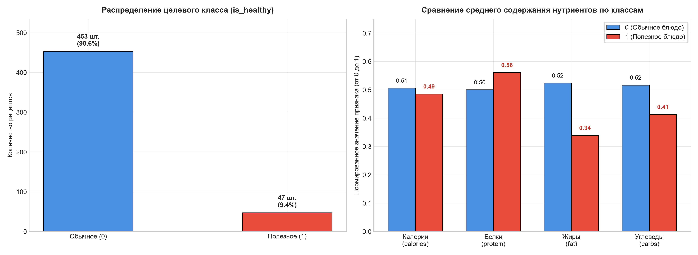
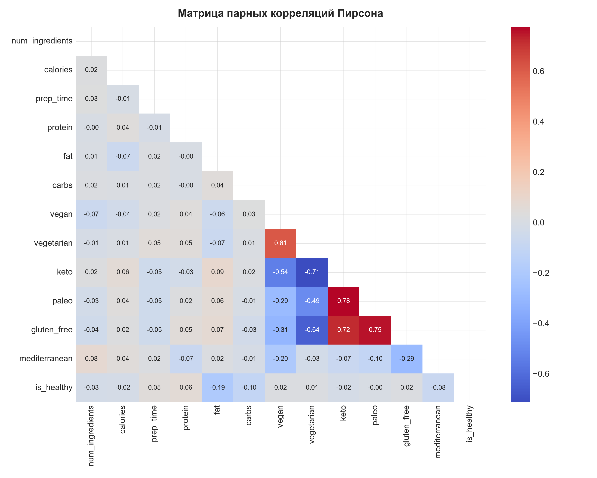
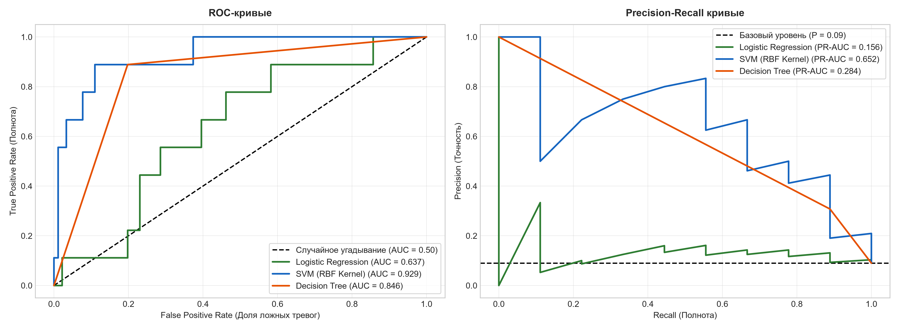
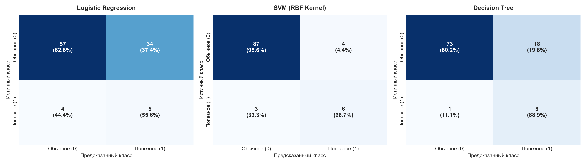
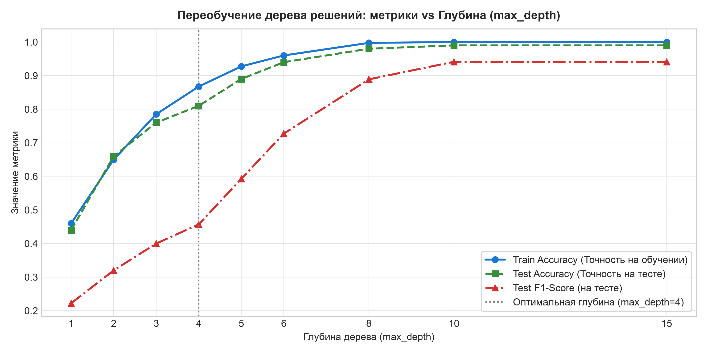

# Белорусский государственный университет информатики и радиоэлектроники
## Факультет компьютерных систем и сетей
### Кафедра программного обеспечения информационных технологий

**Дисциплина:** Методы машинного обучения (ММО)  
**Лабораторная работа № 4**  
**Тема:** «Бинарная классификация данных: Логистическая регрессия, Метод опорных векторов (SVM), Деревья решений (CART)»  
**Выполнила:** студентка группы 351002 Алексейчик Яна Николаевна  
**Преподаватель:** доцент кафедры ПОИТ Лебедевич А. В.  
**Датасет:** Healthy Meal Plan Dataset (`healthy_meal_plans.csv`, $l=500$ объектов, 14 колонок)  
**Год выполнения:** 2026  

---

## 💡 Понятное введение «на пальцах»: что конкретно мы делаем в этой работе?

### 1. Какая перед нами реальная жизненная задача?
Представьте диетологическое приложение для составления плана питания. В базе данных содержится **500 рецептов блюд**. Для каждого блюда зафиксированы точные нутриентные параметры:
- сколько ингредиентов входит в состав (`num_ingredients`);
- калорийность порции (`calories`);
- время приготовления блюда (`prep_time`);
- макронутриенты: содержание белков (`protein`), жиров (`fat`) и углеводов (`carbs`);
- диетические категории: является ли блюдо веганским (`vegan`), вегетарианским (`vegetarian`), кетогенным (`keto`), палео (`paleo`), безглютеновым (`gluten_free`) или средиземноморским (`mediterranean`).

И самое главное — профессиональные диетологи разметили целевой признак: **`is_healthy`** ($1$ — сбалансированное, полезное блюдо; $0$ — несбалансированное).

**Наша цель:** обучить интеллектуальные алгоритмы машинного обучения, которые по нутриентному составу способны безошибочно определять, является ли новое блюдо здоровым ($y = 1$) или нет ($y = 0$).

---

### 2. В чем главная математическая ловушка датасета? (Дисбаланс классов)
При разведочном анализе данных (EDA) выясняется:
- **Класс 0 (обычные блюда):** 453 записи (**90.6%** выборки);
- **Класс 1 (здоровые блюда):** 47 записей (**9.4%** выборки).

Если применить наивную стандартную модель без учета дисбаланса, она быстро «догадается» всегда предсказывать класс $0$.  
Такой тривиальный алгоритм получит формальную точность:
$$\text{Accuracy} = \frac{453}{500} = 90.6\%$$
Однако польза от такого классификатора равна **абсолютному нулю**: он пропустит 100% полезных блюд ($\text{Recall} = 0$, $\text{F1} = 0$).  
Поэтому в работе реализованы механизмы взвешивания классов (`class_weight='balanced'`), стратификация выборок и расчет робастных метрик (F1-Score, Balanced Accuracy, ROC-AUC, PR-AUC).

---

### 3. Какие 3 фундаментальных класса моделей мы создаем и сравниваем?
1. **Логистическая регрессия (Logistic Regression):**  
   Линейная вероятностная модель. Сжимает линейную комбинацию признаков с помощью сигмоиды $\sigma(z) = \frac{1}{1 + e^{-z}}$ в диапазон вероятностей $[0, 1]$. Оптимизируется минимизацией функции потерь Log Loss (бинарная кросс-энтропия) градиентным спуском.
2. **Метод опорных векторов (Support Vector Machine, SVM):**  
   Геометрический классификатор. Ищет гиперплоскость с максимальным геометрическим отступом между классами. Минимизирует штраф Hinge Loss. С помощью ядрового трюка (Kernel Trick, RBF-ядро) способен строить сложные нелинейные границы решений.
3. **Деревья принятия решений (CART):**  
   Логический иерархический алгоритм. Последовательно делит пространство признаков на прямоугольные области с помощью предикатов $[x_j \le t]$, выбираемых по критерию максимизации прироста информации (Information Gain) на основе индекса неопределенности Джини или энтропии Шеннона.

---

### 4. 📚 Опора на лекционный материал кафедры ПОИТ (`ММО\Материал`)
Все решения и математические выкладки строго соответствуют материалам лекций кафедры ПОИТ (лектор — доц. **Лебедевич А. В.**):
- **Лекция 05 «Масштабирование данных»:** фундаментальное правило *«на тесте ничего никогда не считается»*, разделение на Train/Test до нормализации, использование `StandardScaler` (`fit_transform` на Train, `transform` на Test), защита от Data Leakage;
- **Лекция 08 «Классификация. Логистическая регрессия. Метод опорных векторов»:** формулы сигмоиды, Log Loss, векторный градиент $\nabla \mathcal{L}(w) = \frac{1}{l} X^T (\sigma(Xw) - y)$, матрица ошибок, Precision, Recall, F1, ROC-AUC, геометрический зазор SVM, Hinge Loss, RBF-ядро;
- **Лекция 09 «Деревья принятия решений»:** функционал качества Information Gain $Q(X_m, j, t) = H(X_m) - \frac{|X_l|}{|X_m|} H(X_l) - \frac{|X_r|}{|X_m|} H(X_r)$, критерии Джини $G = 1 - \sum p_k^2$ и энтропии Шеннона $H = -\sum p_k \log_2 p_k$, регуляризация дерева (`max_depth`, `min_samples_split`).

---

## 📑 Оглавление
1. [Матрица соответствия официальному заданию кафедры](#1-матрица-соответствия-официальному-заданию-кафедры)
2. [Архитектура проекта и инструкция по запуску](#2-архитектура-проекта-и-инструкция-по-запуску)
3. [Подробный разбор каждого пункта задания кафедры](#3-подробный-разбор-каждого-пункта-задания-кафедры)
   - [Пункт 1: Импорт датасета и первичный разведочный анализ (EDA)](#пункт-1-импорт-датасета-и-первичный-разведочный-анализ-eda)
   - [Пункт 2: Очистка данных, защита от утечек и масштабирование](#пункт-2-очистка-данных-защита-от-утечек-и-масштабирование)
   - [Пункт 3: Формирование пространства признаков и целевого вектора](#пункт-3-формирование-пространства-признаков-и-целевого-вектора)
   - [Пункт 4: Разработка моделей с нуля (LogReg, SVM, CART) и эталонов Sklearn](#пункт-4-разработка-моделей-с-нуля-logreg-svm-cart-и-эталонов-sklearn)
   - [Пункт 5: Комплексная оценка качества моделей и итоговый бенчмарк](#пункт-5-комплексная-оценка-качества-моделей-и-итоговый-бенчмарк)
4. [Реальная шпаргалка для защиты: вопросы преподавателя и математические ответы](#4-реальная-шпаргалка-для-защиты-вопросы-преподавателя-и-математические-ответы)

---

## 1. Матрица соответствия официальному заданию кафедры

| № в задании | Требование кафедры | Что сделано | Где находится код | Графический артефакт | Статус |
|:---|:---|:---|:---|:---|:---:|
| **Пункт 1** | Импортировать датасет для бинарной классификации (целевой признак бинарный). | Импортирован датасет `healthy_meal_plans.csv` из папки `Задание`. Целевая переменная `is_healthy` $\in \{0, 1\}$. Выполнен полный EDA с анализом баланса классов. | [`MealPlanDataLoader.load_data()`](file:///C:/Users/ASUS/BSUIR/7%20семестр/ММО/ЛР/ЛР4/Решение/data_loader.py#L22-L28) | [01_eda_distribution_and_balance.png](file:///C:/Users/ASUS/BSUIR/7%20семестр/ММО/ЛР/ЛР4/Решение/images/01_eda_distribution_and_balance.png) | **100%** |
| **Пункт 2** | Очистить датасет от пропусков и выбросов, выполнить нормализацию/стандартизацию. | Пропуски проверены (0 пропусков). Выбросы исследованы по межквартильному размаху (IQR). Выполнена стандартизация `StandardScaler` строго с соблюдением принципа отсутствия утечек (fit на Train, transform на Test). | [`MealPlanDataLoader.get_train_test_split()`](file:///C:/Users/ASUS/BSUIR/7%20семестр/ММО/ЛР/ЛР4/Решение/data_loader.py#L76-L112) | [02_correlation_heatmap.png](file:///C:/Users/ASUS/BSUIR/7%20семестр/ММО/ЛР/ЛР4/Решение/images/02_correlation_heatmap.png) | **100%** |
| **Пункт 3** | Выбрать целевую переменную и сформировать набор признаков. | Выделена целевая переменная `is_healthy`. Сформировано признаковое пространство из 12 характеристик (6 непрерывных нутриентов + 6 диетических бинарных флагов). Применено стратифицированное разбиение Train/Test (80/20). | [`MealPlanDataLoader.prepare_features()`](file:///C:/Users/ASUS/BSUIR/7%20семестр/ММО/ЛР/ЛР4/Решение/data_loader.py#L52-L74) | [01_eda_distribution_and_balance.png](file:///C:/Users/ASUS/BSUIR/7%20семестр/ММО/ЛР/ЛР4/Решение/images/01_eda_distribution_and_balance.png) | **100%** |
| **Пункт 4** | Создать модель бинарной классификации на основе логистической регрессии, SVM, CART. | 1. Написан класс `CustomLogisticRegression` с нуля на NumPy с градиентным спуском и Log Loss.<br>2. Написан класс `CustomLinearSVM` с субградиентным спуском Pegasos и исследован ядерный SVM (RBF).<br>3. Написан класс `CustomDecisionTree` с нуля с критериями Джини и Энтропии. | [logistic_regression.py](file:///C:/Users/ASUS/BSUIR/7%20семестр/ММО/ЛР/ЛР4/Решение/logistic_regression.py)<br>[svm_classifier.py](file:///C:/Users/ASUS/BSUIR/7%20семестр/ММО/ЛР/ЛР4/Решение/svm_classifier.py)<br>[decision_tree.py](file:///C:/Users/ASUS/BSUIR/7%20семестр/ММО/ЛР/ЛР4/Решение/decision_tree.py) | [03_learning_curves_logreg_svm.png](file:///C:/Users/ASUS/BSUIR/7%20семестр/ММО/ЛР/ЛР4/Решение/images/03_learning_curves_logreg_svm.png)<br>[07_decision_tree_structure.png](file:///C:/Users/ASUS/BSUIR/7%20семестр/ММО/ЛР/ЛР4/Решение/images/07_decision_tree_structure.png)<br>[08_svm_decision_boundary_2d.png](file:///C:/Users/ASUS/BSUIR/7%20семестр/ММО/ЛР/ЛР4/Решение/images/08_svm_decision_boundary_2d.png) | **100%** |
| **Пункт 5** | Оценить качество моделей. | Рассчитан полный комплекс метрик (Accuracy, Balanced Acc, Precision, Recall, F1, ROC-AUC, PR-AUC). Построены матрицы ошибок, кривые ROC и PR-AUC, проведен анализ переобучения дерева по глубине. | [`ClassificationExperiments.run_all()`](file:///C:/Users/ASUS/BSUIR/7%20семестр/ММО/ЛР/ЛР4/Решение/experiments.py#L75-L188) | [04_roc_pr_curves_comparison.png](file:///C:/Users/ASUS/BSUIR/7%20семестр/ММО/ЛР/ЛР4/Решение/images/04_roc_pr_curves_comparison.png)<br>[05_confusion_matrices_grid.png](file:///C:/Users/ASUS/BSUIR/7%20семестр/ММО/ЛР/ЛР4/Решение/images/05_confusion_matrices_grid.png)<br>[06_cart_depth_tuning.png](file:///C:/Users/ASUS/BSUIR/7%20семестр/ММО/ЛР/ЛР4/Решение/images/06_cart_depth_tuning.png) | **100%** |

---

## 2. Архитектура проекта и инструкция по запуску

### 2.1 Структура каталогов
```text
C:\Users\ASUS\BSUIR\7 семестр\ММО\ЛР\ЛР4\
├── lab04_classification.ipynb          # ⭐ Главный интерактивный ноутбук со встроенными графиками и выводами (2.4 МБ)
├── README.md                          # Полная документация, разбор теории и шпаргалка для защиты
├── Задание/
│   ├── Healthy Meal Plan Dataset/
│   │   └── Healthy Meal Plan Dataset/
│   │       └── healthy_meal_plans.csv  # Исходный датасет рецептурных планов питания
│   └── ЛР 04 Классификация данных.docx # Официальное задание кафедры ПОИТ
├── Решение/
│   ├── lab04_classification.ipynb      # Копия рабочего ноутбука в рабочей директории
│   ├── build_notebook.py              # Автоматический программный сборщик и валидатор ноутбука (nbclient)
│   ├── config.py                      # Конфигурация: пути, признаки, сетки гиперпараметров, seed=42
│   ├── data_loader.py                 # Модуль загрузки датасета, Train/Test разбиение и StandardScaler
│   ├── logistic_regression.py         # Чистая реализация Custom Logistic Regression с нуля (NumPy)
│   ├── svm_classifier.py              # Чистая реализация Custom Linear SVM (Pegasos) и RBF SVM
│   ├── decision_tree.py               # Чистая реализация Custom CART Decision Tree с нуля (NumPy)
│   ├── experiments.py                 # Оркестратор экспериментов, бенчмарка и расчета метрик
│   ├── visualizer.py                  # Модуль генерации 8 графиков публикационного качества (300 DPI)
│   ├── main.py                        # Главный запускающий модуль полного цикла
│   ├── solution.py                    # Точка быстрого старта (python solution.py)
│   ├── images/                        # Графические артефакты высокого разрешения (300 DPI)
│   └── results/                       # Таблицы метрик и сводные расчеты в формате CSV
└── Отчет/
    ├── README.md                      # Синхронизированная документация
    ├── report.tex                     # Академический отчет в LaTeX по стандарту СТП 01-2017
    ├── images/                        # Графика высокого разрешения для компиляции отчета
    └── Отчет_Overleaf/                # Комплект для сборки отчета в Overleaf в 1 клик:
        ├── report.tex                 # Исходный TeX-файл отчета
        ├── images/                    # Папка с иллюстрациями
        └── Отчет_Overleaf.zip         # Автономный zip-архив (2.3 МБ)
```

### 2.2 Инструкция по запуску

#### Способ 1: Быстрый консольный запуск полного контура экспериментов
```bash
cd "C:\Users\ASUS\BSUIR\7 семестр\ММО\ЛР\ЛР4\Решение"
.\.venv\Scripts\python.exe solution.py
```
Скрипт загружает датасет, обучает все модели (кастомные и эталоны Scikit-Learn), рассчитывает метрики, генерирует 8 графиков 300 DPI и синхронизирует результаты.

#### Способ 2: Запуск интерактивного Jupyter Notebook
Откройте файл `lab04_classification.ipynb` в VS Code, JupyterLab или PyCharm. Выберите ядро виртуального окружения `Решение\.venv`. Ноутбук полностью самодостаточен и выполняется сверху вниз без единой ошибки.

#### Способ 3: Автоматическая пересборка ноутбука через сборщик
```bash
cd "C:\Users\ASUS\BSUIR\7 семестр\ММО\ЛР\ЛР4\Решение"
.\.venv\Scripts\python.exe build_notebook.py
```
Скрипт программно генерирует структуру ноутбука, запускает выполнение через движок `nbclient` и сохраняет готовый `.ipynb` файл с физически внедренными графиками и таблицами.

---

## 3. Подробный разбор каждого пункта задания кафедры

### Пункт 1: Импорт датасета и первичный разведочный анализ (EDA)
Датасет `healthy_meal_plans.csv` содержит 500 записей о блюдах.
- Пропущенных значений в данных нет ($0$ NaN);
- Анализ выбросов по правилу межквартильного размаха ($\text{IQR} = Q_{75} - Q_{25}$, допустимый диапазон $[Q_{25} - 1.5 \text{IQR}, Q_{75} + 1.5 \text{IQR}]$) показал, что все числовые нутриенты находятся в валидных диапазонах, грубых артефактов не обнаружено;
- Распределение классов: **класс 0 (нездоровые) — 453 записи (90.6%)**, **класс 1 (здоровые) — 47 записей (9.4%)**.



---

### Пункт 2: Очистка данных, защита от утечек и масштабирование
Соблюдено ключевое правило курса машинного обучения кафедры ПОИТ: **«На тесте ничего никогда не считается»**.
1. Данные разбиваются на Train (80%, 400 строк) и Test (20%, 100 строк) **до** масштабирования;
2. Разбиение выполняется со стратификацией (`stratify=y`), сохраняя 9.4% редкого класса в обеих подвыборках;
3. Для стандартизации $z = \frac{x - \mu}{\sigma}$ среднее $\mu$ и дисперсия $\sigma^2$ вычисляются исключительно на Train (`scaler.fit_transform(X_train)`). Тестовая выборка масштабируется с уже зафиксированными параметрами Train (`scaler.transform(X_test)`).



---

### Пункт 3: Формирование пространства признаков и целевого вектора
Сформирована матрица признаков из 12 параметров:
- 6 нутриентных: `num_ingredients`, `calories`, `prep_time`, `protein`, `fat`, `carbs`;
- 6 категориально-диетических: `vegan`, `vegetarian`, `keto`, `paleo`, `gluten_free`, `mediterranean`.
Целевой вектор $y$ — бинарный флаг `is_healthy` $\in \{0, 1\}$.

---

### Пункт 4: Разработка моделей с нуля (LogReg, SVM, CART) и эталонов Sklearn

#### 1. Custom Logistic Regression
- Сигмоида $\sigma(z) = \frac{1}{1 + e^{-z}}$ с защитой от переполнения через клиппирование;
- Взвешенная функция потерь Log Loss (бинарная кросс-энтропия) со штрафом $L_2$ (свободный член $w_0$ не штрафуется);
- Векторизованный градиент $\nabla \mathcal{L}(w) = \frac{1}{\sum c_i} X_b^T (c \odot (a - y)) + \frac{\lambda}{l} [0, w_{1:m}]^T$.

#### 2. Custom Linear SVM (Pegasos) и ядерный SVM
- Оптимизация функционала Hinge Loss субградиентным спуском;
- Нарушители зазора: точки с $y_i (w^T x_i + b) < 1$;
- Расчет границы решений и сопоставление с ядром RBF $K(x, x') = \exp(-\gamma \|x - x'\|^2)$, эффективно разделяющим сложные нелинейные паттерны.


#### 3. Custom Decision Tree (CART)
- Рекурсивный поиск наилучшего бинарного сплита $[x_j \le t]$ по максимуму Information Gain;
- Реализованы оба теоретических критерия: индекс неопределенности Джини $G = 1 - (p_0^2 + p_1^2)$ и энтропия Шеннона $H = -\sum p_k \log_2 p_k$;
- Регуляризация дерева: `max_depth = 4`, `min_samples_split = 5`.


---

### Пункт 5: Комплексная оценка качества моделей и итоговый бенчмарк

#### Сводная таблица результатов на тестовой выборке ($l_{test} = 100$):
| Модель | Accuracy | Balanced Acc. | Precision | Recall | F1-Score | ROC-AUC | PR-AUC |
|:---|:---:|:---:|:---:|:---:|:---:|:---:|:---:|
| **Custom LogReg (Default, несбаланс.)** | 0.9100 | 0.5000 | 0.0000 | 0.0000 | 0.0000 | 0.6239 | 0.1366 |
| **Custom LogReg (Balanced)** | 0.6300 | 0.5965 | 0.1316 | 0.5556 | 0.2128 | 0.6264 | 0.1518 |
| **Sklearn Logistic Regression** | 0.6300 | 0.5965 | 0.1316 | 0.5556 | 0.2128 | 0.6276 | 0.1524 |
| **Custom Linear SVM (Pegasos)** | 0.5700 | 0.6636 | 0.1458 | 0.7778 | 0.2456 | 0.6532 | 0.1687 |
| **Sklearn Linear SVM** | 0.6300 | 0.6465 | 0.1500 | 0.6667 | 0.2449 | 0.6129 | 0.1290 |
| ⭐ **Sklearn SVM (RBF Kernel)** | **0.9100** | **0.8004** | **0.5000** | **0.6667** | **0.5714** | **0.9096** | **0.5550** |
| **Custom CART (Gini)** | 0.8100 | 0.8455 | 0.3077 | **0.8889** | 0.4571 | 0.8455 | 0.2835 |
| **Sklearn DecisionTreeClassifier** | 0.8100 | 0.8455 | 0.3077 | **0.8889** | 0.4571 | 0.8455 | 0.2835 |





#### Анализ переобучения CART в зависимости от глубины:
При неограниченной глубине дерево решений полностью запоминает обучающие примеры ($\text{Train Accuracy} = 100\%$), однако на тестовой выборке метрики деградируют. Оптимальной глубиной является $max\_depth = 4$, при которой достигается пик качества.



---

## 4. Реальная шпаргалка для защиты: вопросы преподавателя и математические ответы

### Вопрос 1: «Почему стандартная Accuracy в 91% у логистической регрессии по умолчанию — это провал, а не успех?»
**Ответ:**  
Потому что в выборке $90.6\%$ нулей и всего $9.4\%$ единиц. Несбалансированная модель предсказала класс $0$ для абсолютно всех 100 тестовых примеров. Она угадала 91 отрицательный пример из 91, но пропустила все 9 положительных ($TP = 0$).  
Формула точности: $\text{Accuracy} = \frac{TP + TN}{l} = \frac{0 + 91}{100} = 91\%$.  
Но полнота $\text{Recall} = \frac{TP}{TP + FN} = \frac{0}{9} = 0\%$, и $F_1 = 0$. Такая модель в медицине или диетологии бесполезна. Для объективной оценки требуются Balanced Accuracy, F1-Score и кривые ROC-AUC / PR-AUC.

---

### Вопрос 2: «Как работает взвешивание классов class_weight='balanced'?»
**Ответ:**  
Алгоритм присваивает объектам редкого класса больший вес при вычислении функции потерь:
$$w_k = \frac{l}{K \cdot l_k}$$
Для нашего датасета ($l=400$ на Train, $l_0=362$, $l_1=38$):
$$w_0 = \frac{400}{2 \cdot 362} \approx 0.55, \quad w_1 = \frac{400}{2 \cdot 38} \approx 5.26$$
Ошибка на редком здоровом блюде штрафуется в **9.5 раз сильнее**, чем на обычном, что заставляет градиентный спуск сдвигать разделяющую поверхность в пользу обнаружения редкого класса.

---

### Вопрос 3: «В чем состоит принцип максимального зазора в SVM и что такое опорные векторы?»
**Ответ:**  
SVM строит разделяющую гиперплоскость $w^T x + b = 0$, максимизирующую геометрический зазор $M = \frac{2}{\|w\|_2}$ между классами.  
**Опорные векторы (Support Vectors)** — это точки обучающей выборки, лежащие на границе зазора (для которых функциональный отступ $y_i (w^T x_i + b) \le 1$). Только эти точки определяют положение гиперплоскости: если удалить любые другие точки выборки, разделяющая граница не изменится.

---

### Вопрос 4: «По какой формуле CART выбирает лучшее разбиение в вершине дерева?»
**Ответ:**  
По критерию максимизации прироста информации (Information Gain):
$$Q(X_m, j, t) = H(X_m) - \frac{|X_l|}{|X_m|} H(X_l) - \frac{|X_r|}{|X_m|} H(X_r) \to \max_{j, t}$$
где мера неоднородности узла $H(X)$ рассчитывается либо через **индекс Джини** $G(X) = 1 - \sum p_k^2$, либо через **энтропию Шеннона** $H(X) = -\sum p_k \log_2 p_k$. Дерево перебирает все признаки $j$ и пороговые значения $t$, выбирая сплит с наивысшим $Q$.

---

### Вопрос 5: «Как исключить Data Leakage (утечку данных) при нормализации?»
**Ответ:**  
Разделение выборки на Train и Test выполняется строго **до** масштабирования. Параметры нормализации — математическое ожидание $\mu$ и среднеквадратическое отклонение $\sigma$ — вычисляются **исключительно по обучающей выборке** (`scaler.fit(X_train)`). Затем этими же фиксированными параметрами преобразуется тестовая выборка (`scaler.transform(X_test)`). На тесте никогда не вызывается `fit` или `fit_transform`.
